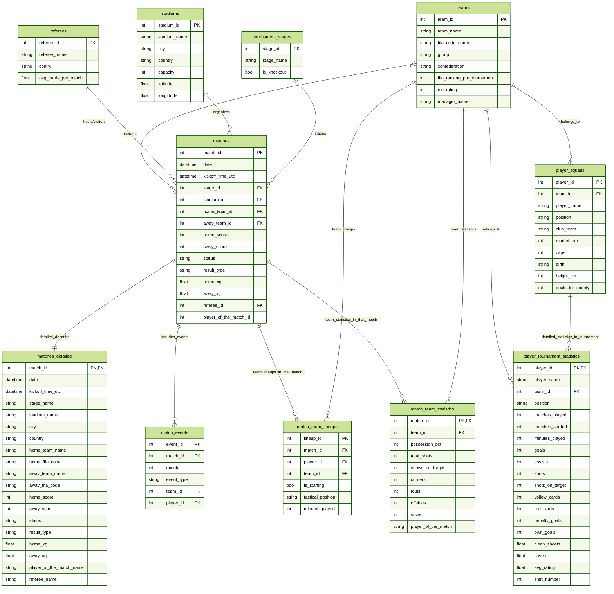
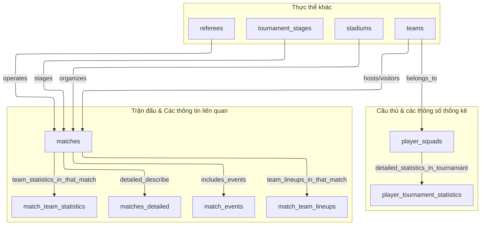

# ⚽ WorldCup26 Management

> Hệ thống quản lý giải đấu **FIFA World Cup 2026**


---

## 📑 Mục lục

- [📁 Cấu trúc dự án](#-cấu-trúc-dự-án)
- [🗄️ Database Schema (Chuẩn 3NF)](#️-database-schema-chuẩn-3nf)
- [🛠️ Installation & Usage](#️-installation--usage)
- [🌐 Tính năng chính](#-tính-năng-chính)

---

## 📁 Cấu trúc dự án

```text
wc26_management/
├── datasets/                         # 11 file CSV nguồn dữ liệu
│   ├── referees.csv
│   ├── stadiums.csv
│   ├── tournament_stages.csv
│   ├── teams.csv
│   ├── player_squads.csv
│   ├── player_tournament_statistics.csv
│   ├── matches.csv
│   ├── matches_detailed.csv
│   ├── match_events.csv
│   ├── match_team_lineups.csv
│   └── match_team_statistics.csv
│
├── server/                           
│   ├── server.js                     # REST API, kết nối SQL Server
│   ├── package.json
│   ├── package-lock.json
│   ├── .env.example                                          
│
├── public/                           # Giao diện web (server phục vụ thư mục này)
│   ├── index.html                    
│   ├── app.js                        
│   ├── styles.css                   
│   ├── wc2026-logo.png
│   └── logo-ptit.png
│   
├── sql/                          # Tạo database, 11 bảng, nạp dữ liệu từ CSV
│   ├── init.sql                    
│   ├── view.sql                        
│   ├── function.sql                   
│   ├── procedure.sql
│   └── query.sql
│                       
├── prepare_data.py                   
├── update_data.py                    
├── BaoCao.docx                       
└── README.md
```

---

## 🗄️ Database Schema (Chuẩn 3NF)

### 🔗 Mô hình ERD:  [Tham khảo](https://mermaid.ai/app/projects/b2492da4-6c0f-4042-a14a-d2d4fa95d192/diagrams/1a4d992f-30ac-45cd-a2f2-1da8ca403676/version/v0.1/edit)




****

**ERD dạng flow:** [Tham khảo](https://mermaid.ai/app/projects/b2492da4-6c0f-4042-a14a-d2d4fa95d192/diagrams/fd5c7566-2a06-41dc-921f-cfb3cd8c2611/version/v0.1/edit)



### 🧩 Mô hình quan hệ (RM)

Mỗi thực thể (bảng) được mô tả bằng một bảng thuộc tính. Ký hiệu: **PK** = khóa chính, **FK** = khóa ngoại (`→ bảng(cột)` là bảng được tham chiếu).

#### `1. referees`

📄 `referees.csv` — Trọng tài: mã, tên, quốc gia, số thẻ trung bình mỗi trận

| Thuộc tính | Kiểu dữ liệu | Khóa | Ràng buộc / Ghi chú |
|---|---|:---:|---|
| `referee_id` | int | **PK** |  |
| `referee_name` | nvarchar(100) |  | NOT NULL |
| `country` | nvarchar(100) |  | NOT NULL |
| `avg_cards_per_match` | float |  |  |

#### `2. stadiums`

📄 `stadiums.csv` — Sân vận động: tên, thành phố, quốc gia, sức chứa, tọa độ

| Thuộc tính | Kiểu dữ liệu | Khóa | Ràng buộc / Ghi chú |
|---|---|:---:|---|
| `stadium_id` | int | **PK** |  |
| `stadium_name` | nvarchar(100) |  | NOT NULL |
| `city` | nvarchar(100) |  | NOT NULL |
| `country` | nvarchar(100) |  | NOT NULL |
| `capacity` | int |  |  |
| `latitude` | float |  |  |
| `longitude` | float |  |  |

#### `3. tournament_stages`

📄 `tournament_stages.csv` — Các vòng đấu (vòng bảng, knockout...) và cờ loại trực tiếp

| Thuộc tính | Kiểu dữ liệu | Khóa | Ràng buộc / Ghi chú |
|---|---|:---:|---|
| `stage_id` | int | **PK** |  |
| `stage_name` | nvarchar(100) |  | NOT NULL |
| `is_knockout` | int |  |  |

#### `4. teams`

📄 `teams.csv` — Đội tuyển: mã FIFA, bảng đấu, liên đoàn, hạng FIFA, Elo, HLV

| Thuộc tính | Kiểu dữ liệu | Khóa | Ràng buộc / Ghi chú |
|---|---|:---:|---|
| `team_id` | int | **PK** |  |
| `team_name` | nvarchar(100) |  | NOT NULL |
| `fifa_code_name` | nvarchar(100) |  | NOT NULL |
| `groupp` | nvarchar(10) |  | NOT NULL |
| `confederation` | nvarchar(100) |  | NOT NULL |
| `fifa_ranking_per_tournament` | int |  |  |
| `elo_rating` | float |  |  |
| `coach_name` | nvarchar(100) |  |  |

#### `5. player_squads`

📄 `player_squads.csv` — Hồ sơ cầu thủ: vị trí, CLB, giá trị, số lần khoác áo, ngày sinh, chiều cao

| Thuộc tính | Kiểu dữ liệu | Khóa | Ràng buộc / Ghi chú |
|---|---|:---:|---|
| `player_id` | int | **PK** |  |
| `team_id` | int | **FK** | NOT NULL · → teams(team_id) |
| `player_name` | nvarchar(100) |  | NOT NULL |
| `position` | nvarchar(100) |  | NOT NULL |
| `club_team` | nvarchar(100) |  |  |
| `market_eur` | int |  |  |
| `caps` | int |  |  |
| `birth` | date |  |  |
| `height_cm` | int |  |  |
| `goals_for_country` | int |  |  |

#### `6. player_tournament_statistics`

📄 `player_tournament_statistics.csv` — Thống kê cầu thủ toàn giải: trận, phút, bàn thắng, kiến tạo, thẻ, đánh giá, số áo

| Thuộc tính | Kiểu dữ liệu | Khóa | Ràng buộc / Ghi chú |
|---|---|:---:|---|
| `player_id` | int | **PK, FK** | → player_squads(player_id) |
| `player_name` | nvarchar(100) |  | NOT NULL |
| `team_id` | int | **FK** | NOT NULL · → teams(team_id) |
| `position` | nvarchar(100) |  |  |
| `matches_played` | int |  | DEFAULT 0 |
| `matches_started` | int |  | DEFAULT 0 |
| `minutes_played` | int |  | DEFAULT 0 |
| `goals` | int |  | DEFAULT 0 |
| `assists` | int |  | DEFAULT 0 |
| `shots` | int |  | DEFAULT 0 |
| `shots_on_target` | int |  | DEFAULT 0 |
| `yellow_cards` | int |  | DEFAULT 0 |
| `red_cards` | int |  | DEFAULT 0 |
| `penalty_goals` | int |  | DEFAULT 0 |
| `own_goals` | int |  | DEFAULT 0 |
| `clean_sheets` | float |  | DEFAULT 0 |
| `saves` | float |  | DEFAULT 0.0 |
| `avg_rating` | float |  |  |
| `shirt_number` | int |  |  |

#### `matches`

📄 `7. matches.csv` — Trận đấu: ngày giờ, vòng, sân, hai đội, tỉ số, trạng thái, xG, trọng tài, cầu thủ xuất sắc nhất

| Thuộc tính | Kiểu dữ liệu | Khóa | Ràng buộc / Ghi chú |
|---|---|:---:|---|
| `match_id` | int | **PK** |  |
| `datee` | date |  |  |
| `kickoff_time_utc` | time(0) |  |  |
| `stage_id` | int | **FK** | NOT NULL · → tournament_stages(stage_id) |
| `stadium_id` | int | **FK** | NOT NULL · → stadiums(stadium_id) |
| `home_team_id` | int | **FK** | NOT NULL · → teams(team_id) |
| `away_team_id` | int | **FK** | NOT NULL · → teams(team_id) |
| `home_score` | int |  |  |
| `away_score` | int |  |  |
| `statuss` | nvarchar(100) |  |  |
| `result_type` | nvarchar(100) |  |  |
| `home_xg` | float |  |  |
| `away_xg` | float |  |  |
| `referee_id` | int | **FK** | NOT NULL · → referees(referee_id) |
| `player_of_the_match_id` | int | **FK** | → player_squads(player_id) |

#### `8. matches_detailed`

📄 `matches_detailed.csv` — Bản mở rộng của `matches` với tên đội, sân, thành phố, trọng tài

| Thuộc tính | Kiểu dữ liệu | Khóa | Ràng buộc / Ghi chú |
|---|---|:---:|---|
| `match_id` | int | **PK, FK** | → matches(match_id) |
| `datee` | date |  |  |
| `kickoff_time_utc` | time(0) |  |  |
| `stage_name` | nvarchar(100) |  |  |
| `stadium_name` | nvarchar(100) |  |  |
| `city` | nvarchar(100) |  |  |
| `country` | nvarchar(100) |  |  |
| `home_team_name` | nvarchar(100) |  |  |
| `home_fifa_code` | nvarchar(10) |  |  |
| `away_team_name` | nvarchar(100) |  |  |
| `away_fifa_code` | nvarchar(10) |  |  |
| `home_score` | int |  | DEFAULT 0 |
| `away_score` | int |  | DEFAULT 0 |
| `statuss` | nvarchar(100) |  |  |
| `result_type` | nvarchar(100) |  |  |
| `home_xg` | float |  |  |
| `away_xg` | float |  |  |
| `player_of_the_match_name` | nvarchar(100) |  |  |
| `referee_name` | nvarchar(100) |  |  |

#### `9. match_events`

📄 `match_events.csv` — Sự kiện trong trận: bàn thắng, thẻ vàng, thẻ đỏ... theo phút

| Thuộc tính | Kiểu dữ liệu | Khóa | Ràng buộc / Ghi chú |
|---|---|:---:|---|
| `event_id` | int | **PK** |  |
| `match_id` | int | **FK** | NOT NULL · → matches(match_id) |
| `minutee` | int |  | NOT NULL |
| `event_type` | nvarchar(100) |  | NOT NULL |
| `team_id` | int | **FK** | NOT NULL · → teams(team_id) |
| `player_id` | int | **FK** | NOT NULL · → player_squads(player_id) |

#### `10. match_team_lineups`

📄 `match_team_lineups.csv` — Đội hình mỗi trận: đá chính / dự bị, vị trí chiến thuật, số phút

| Thuộc tính | Kiểu dữ liệu | Khóa | Ràng buộc / Ghi chú |
|---|---|:---:|---|
| `lineup_id` | int | **PK** |  |
| `match_id` | int | **FK** | NOT NULL · → matches(match_id) |
| `player_id` | int | **FK** | NOT NULL · → player_squads(player_id) |
| `team_id` | int | **FK** | NOT NULL · → teams(team_id) |
| `is_starting` | int |  | DEFAULT 0 |
| `tactical_position` | nvarchar(100) |  |  |
| `minutes_played` | int |  | DEFAULT 0 |

#### `11. match_team_statistics`

📄 `match_team_statistics.csv` — Thống kê đội mỗi trận: kiểm soát bóng, sút, phạt góc, phạm lỗi

| Thuộc tính | Kiểu dữ liệu | Khóa | Ràng buộc / Ghi chú |
|---|---|:---:|---|
| `match_id` | int | **PK, FK** | → matches(match_id) |
| `team_id` | int | **PK, FK** | → teams(team_id) |
| `possession_pct` | int |  |  |
| `total_shots` | int |  | DEFAULT 0 |
| `shots_on_target` | int |  | DEFAULT 0 |
| `corners` | int |  | DEFAULT 0 |
| `fouls` | int |  | DEFAULT 0 |
| `offsides` | int |  | DEFAULT 0 |
| `saves` | int |  | DEFAULT 0 |
| `player_of_the_match` | nvarchar(100) |  |  |


### 🛠️ Các đối tượng trong CSDL

| Loại | Tên | Công dụng |
|---|---|---|
| 👁️ View | `vw_match_results` | Kết quả các trận đấu |
| 👁️ View | `vw_rank_group_stage` | Bảng xếp hạng vòng bảng |
| 👁️ View | `vw_tournament_team_stats` | Thống kê tổng hợp của từng đội |
| 👁️ View | `vw_tournament_player_stats` | Thống kê của từng cầu thủ |
| ⚙️ Function | `fn_get_points`, `fn_match_outcome` | Điểm và kết quả W/D/L của một trận |
| ⚙️ Function | `fn_player_age` | Tuổi cầu thủ tại một ngày |
| ⚙️ Function | `fn_team_matches` | Tất cả trận của một đội |
| ⚙️ Function | `fn_group_standings` | Bảng xếp hạng một bảng đấu |
| 🔧 Procedure | `sp_get_matches_stage` | Tra cứu lịch thi đấu và kết quả theo vòng đấu |
| ➕ Procedure | `sp_add_team`, `sp_add_player`, `sp_add_match` | Thêm dữ liệu |
| ✏️ Procedure | `sp_update_team`, `sp_update_player`, `sp_update_match` | Cập nhật dữ liệu |
| 🗑️ Procedure | `sp_delete_player`, `sp_delete_team`, `sp_delete_match` | Xóa dữ liệu (tham số `@force` để xóa kèm dữ liệu liên quan) |

---

## 🛠️ Installation & Usage

### 📌 4.1 Yêu cầu

- **SQL Server** (Express hoặc Developer) và **SQL Server Management Studio (SSMS)**
- **Node.js** 18 trở lên
- SQL Server đã bật **SQL Server and Windows Authentication mode** và giao thức **TCP/IP** (SQL Server Configuration Manager)

### 🗄️ 4.2 Tạo cơ sở dữ liệu

1. Mở SSMS, mở file `init.sql`.
2. Sửa đường dẫn CSV trong các lệnh `BULK INSERT` (nhập file dữ liệu vào bảng) cho đúng thư mục, ví dụ:
   `D:\wc26_management\datasets\teams.csv`
3. Chạy lần lượt các file theo đúng thứ tự:

| Thứ tự | File | Ghi chú |
|---|---|---|
| 1 | `init.sql` | Tạo database, bảng, nạp dữ liệu |
| 2 | `query.sql`| Truy vấn nghiệp vụ |
| 3 | `view.sql` | Tạo View |
| 4 | `function.sql` | Tạo Function |
| 5 | `procedure.sql` | Tạo Stored - Procedure |

### 🚀 4.3 Chạy ứng dụng web

**1️⃣ Bước 1. Cài thư viện**

```bash
cd D:\wc26_management\server
npm install express cors mssql dotenv
```

**2️⃣ Bước 2. Tạo file `.env`**

```env
DB_SERVER=localhost
DB_NAME=WorldCup26_db
DB_USER= sa
DB_PASSWORD= your_password
# DB_PORT=1433        
# PORT=3000           
```

Nếu dùng named instance (ví dụ `localhost\SQLEXPRESS`), điền vào `DB_SERVER` đúng tên instance đó.

**3️⃣ Bước 3. Khởi động server**

```bash
node server.js
```

**4️⃣ Bước 4. Mở trình duyệt:** 

### 🖥️ 4.4 Cách sử dụng

| Màn hình | Chức năng |
|---|---|
| 📅 Match Results | Xem lịch thi đấu và kết quả theo vòng đấu / bảng đấu, mở Match Center của từng trận |
| 🏆 Standings | Bảng xếp hạng từng bảng vòng bảng |
| 📊 Team Stats | Thống kê đội, đội hình, phong độ gần đây |
| 👟 Player Stats | Bảng vua phá lưới, thống kê cầu thủ |
| ➕ Create Data | Thêm đội, cầu thủ, trận đấu (ID tự điền sẵn, có thể sửa) |
| ✏️ Update Data | Sửa thông tin đội, cầu thủ và kết quả trận |
| 🗑️ Delete Data | Xóa cầu thủ, đội (kèm cầu thủ), trận đấu |

Thứ tự thao tác nên theo khóa ngoại: **Create / Update:** đội → cầu thủ → trận. **Delete:** cầu thủ → đội → trận.

### 🔌 4.5 Một số API chính

| Method | Đường dẫn | Procedure / đối tượng dùng |
|---|---|---|
| `POST` | `/api/teams`, `/api/players`, `/api/matches` | `sp_add_team`, `sp_add_player`, `sp_add_match` |
| `PUT` | `/api/teams/:id`, `/api/players/:id`, `/api/matches/:id` | `sp_update_team`, `sp_update_player`, `sp_update_match` |
| `DELETE` | `/api/players/:id`, `/api/teams/:id`, `/api/matches/:id` (`?force=1`) | `sp_delete_player`, `sp_delete_team`, `sp_delete_match` |
| `GET` | `/api/standings/:group` | `fn_group_standings` |
| `GET` | `/api/next-ids` | ID kế tiếp cho form Create Data |

---

## 🌐 Tính năng chính

- 📅 Xem lịch thi đấu, kết quả, bảng xếp hạng, thống kê đội và cầu thủ.
- ➕ Thêm / ✏️ sửa / 🗑️ xóa đội, cầu thủ, trận đấu qua stored procedure, có kiểm tra ràng buộc nghiệp vụ và transaction.
- 🗑️ Xóa có kiểm soát: báo trước số dữ liệu liên quan, chỉ xóa kèm khi người dùng xác nhận (`@force`).
- ✨ Thông báo thành công bằng animation (toast + viền sáng quanh card).
- ⚡ Index cho các cột truy vấn thường xuyên, có script đo hiệu năng trước và sau.